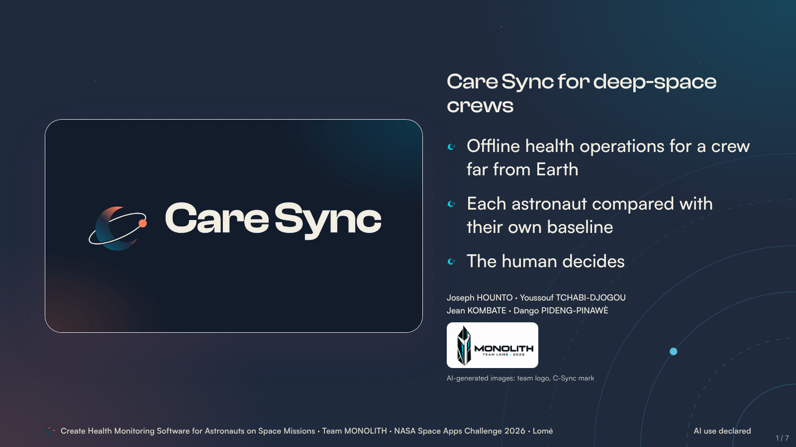
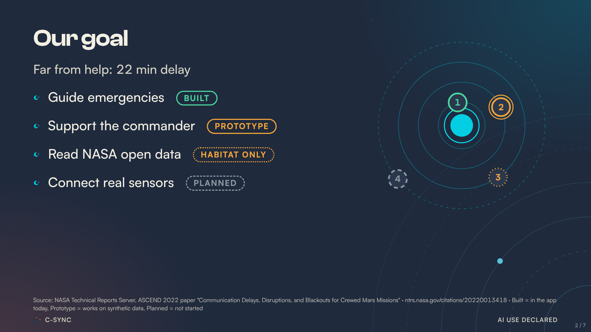
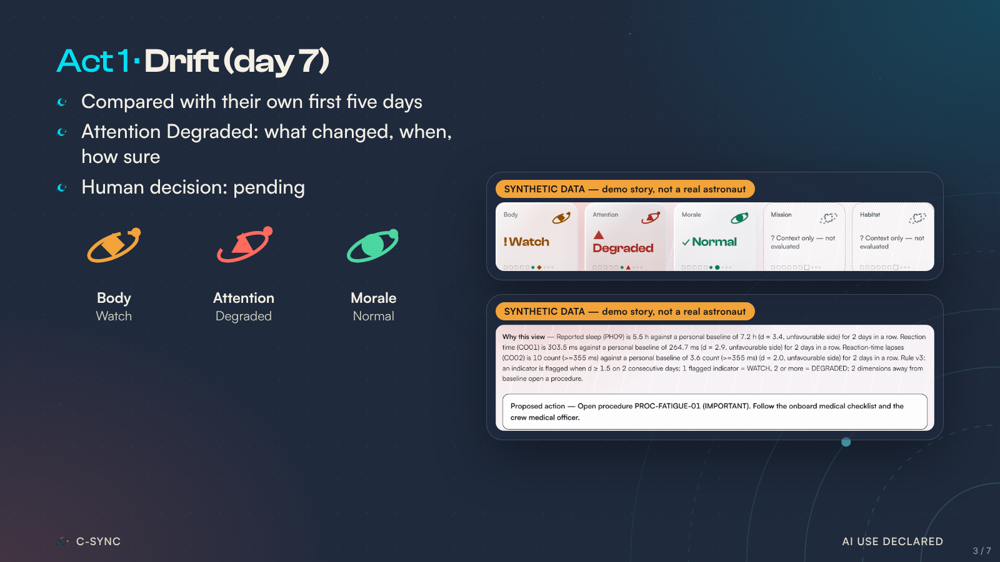
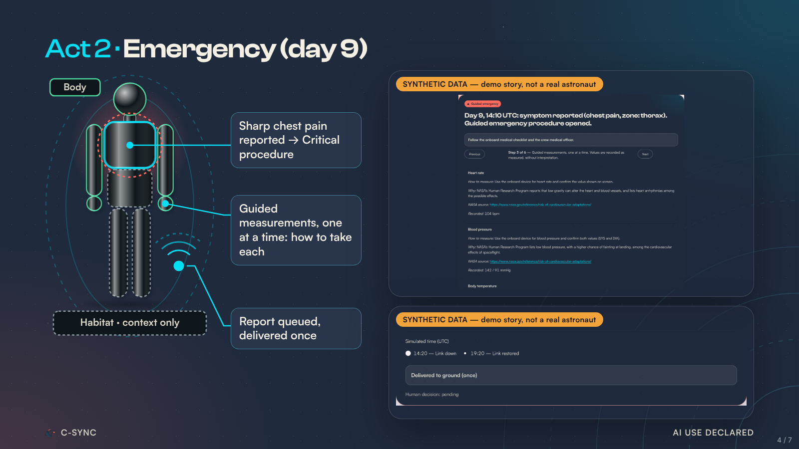
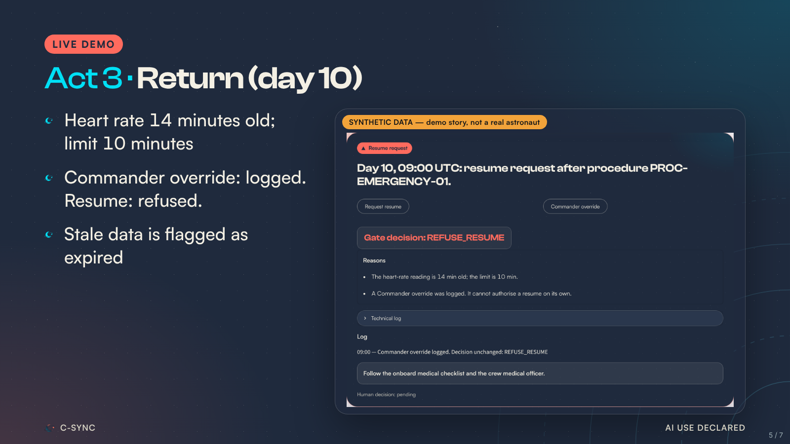
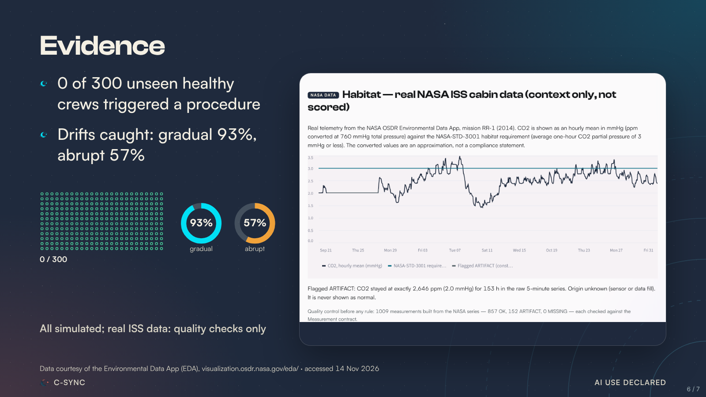
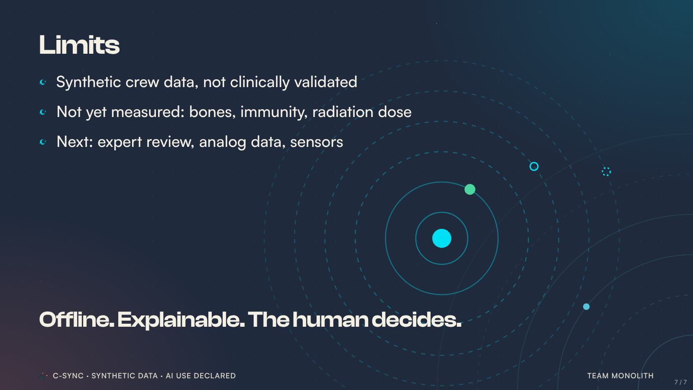

# C-Sync — project demo (7 slides, English)
NASA Space Apps Challenge 2026 · Lomé · Team MONOLITH · Challenge: *Create Health Monitoring Software for Astronauts on Space Missions*

All crew data on the slides is **synthetic** (labelled on every capture). The only real data is NASA ISS cabin telemetry, used for context and quality checks. Nothing is clinically validated. AI use: [AI_USAGE.md](../../AI_USAGE.md).

PDF version (download): [C-Sync_pitch_7_slides.pdf](https://github.com/josephhounto-sudo/MONOLITH-NASA-SPACE-CHALLENGE-LOME-2026/raw/main/pitch/deck/C-Sync_pitch_7_slides.pdf)

